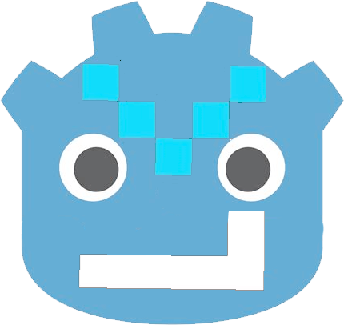

# Godot-LiveKit



**Godot-LiveKit** is a GDExtension for Godot 4.5 that integrates the [LiveKit C++ SDK](https://github.com/livekit/client-sdk-cpp), allowing you to build real-time voice, video, and data applications directly within the Godot Engine using GDScript or C#.

## Features

- **Real-Time Communication**: Connect to LiveKit servers for audio, video, and data streaming.
- **Full Track Support**: Publish and subscribe to audio/video tracks, with local sources for capturing from Godot.
- **Screen Capture**: Capture monitors or individual windows natively using the built-in `LiveKitScreenCapture` class (macOS, Windows, Linux), or whatever the user chooses to share on the web.
- **Audio Processing**: Apply WebRTC echo cancellation, noise suppression, and gain control to audio captured in Godot via `LiveKitAudioProcessingModule`.
- **Data Channels**: Send and receive arbitrary data messages with reliable or unreliable delivery.
- **RPC Support**: Perform remote procedure calls between participants.
- **End-to-End Encryption (E2EE)**: Secure your media streams with configurable encryption, key management, and per-participant frame cryptors.
- **Connection Statistics**: Access detailed WebRTC statistics including inbound/outbound RTP, codecs, transport, and candidate pair metrics.
- **Fast Build Times**: Uses LiveKit's prebuilt C++ SDK on desktop platforms, so builds there only compile `godot-cpp` and the extension. (Android and iOS builds also compile the SDK, which takes longer.)
- **Cross-Platform**: Supports Linux, macOS (Universal), Windows, Android, iOS, and the web (see [Android and iOS](#android-and-ios) and [Web](#web)).
- **Native GDExtension**: Works out-of-the-box with Godot 4.5 without requiring custom engine builds.

## Prerequisites

To build the extension from source, you will need:

- **Python 3.x**
- **SCons** (`pip install scons`)
- **CMake** (Optional, for advanced builds)

**Platform-Specific Requirements:**
- **Linux:** `g++`, `curl`, `tar`, `unzip`
- **macOS:** Xcode Command Line Tools, `curl`, `tar`, `unzip`
- **Windows:** MSVC (Visual Studio Build Tools) or MinGW-w64 (if cross-compiling from Linux/macOS)
- **Web:** `emcc` from [emsdk](https://emscripten.org), at the version Godot's web templates were built with (4.0.11 for Godot 4.5), plus `curl` and `tar`
- **Android:** the Android NDK (r27 or later) in `ANDROID_NDK_ROOT`, plus `git`, CMake, Ninja and Rust (`rustup`) to build the LiveKit SDK
- **iOS:** macOS with Xcode, plus `git`, CMake, Ninja and Rust (`rustup`) to build the LiveKit SDK

## Building from Source

This repository includes a custom `build.sh` script that fetches the LiveKit C++ SDK (building it from source for Android and iOS) and `godot-cpp`, and compiles the extension.

1. **Clone the repository:**
   ```bash
   git clone https://github.com/NodotProject/godot-livekit.git
   cd godot-livekit
   ```

2. **Run the build script for your platform:**

   - **Linux:**
     ```bash
     ./build.sh linux
     ```
   - **macOS:**
     ```bash
     ./build.sh macos
     ```
   - **Windows:**
     ```bash
     ./build.sh windows
     ```
   - **Web:**
     ```bash
     ./build.sh web
     ```
   - **Android** (arm64, or `x86_64` for emulators):
     ```bash
     ./build.sh android
     ```
   - **iOS** (devices, then the simulator; each build adds to the same `.xcframework`s):
     ```bash
     ./build.sh ios
     ./build.sh ios --simulator
     ```

Once the build is complete, the compiled libraries (`.so`, `.dylib`, `.dll`, or `.xcframework`) and the LiveKit shared libraries will be placed in the `addons/godot-livekit/bin/` directory.

## Usage in Godot

1. Copy the `addons/godot-livekit` folder into your Godot project's `addons/` directory. Godot loads the extension when the project opens.
2. You can now access LiveKit classes directly from GDScript:

```gdscript
extends Node

var room: LiveKitRoom

func _ready():
    room = LiveKitRoom.new()
    room.connected.connect(_on_connected)
    room.participant_connected.connect(_on_participant_connected)
    room.track_subscribed.connect(_on_track_subscribed)
    room.data_received.connect(_on_data_received)
    room.connect_to_room("wss://your-server.url", "your-token", {})

# No _process() needed — rooms, video streams, and screen captures are
# auto-polled every frame by default. Set auto_poll = false if you prefer
# to call poll_events() / poll() manually.

func _on_connected():
    print("Connected as: ", room.get_local_participant().get_identity())

func _on_participant_connected(participant):
    print("Joined: ", participant.get_identity())

func _on_track_subscribed(track, publication, participant):
    print("Track subscribed: ", track.get_name())

func _on_data_received(data, participant, kind, topic):
    print("Data from ", participant.get_identity(), ": ", data.get_string_from_utf8())
```

### Screen Capture

You can capture screens and windows natively:

```gdscript
var capture = LiveKitScreenCapture.create()
capture.frame_received.connect(_on_frame)
capture.start()

func _on_frame():
    var image = capture.get_image()
    # Feed into a LiveKitVideoSource for screen sharing
```

## Android and iOS

The Android and iOS builds include every class except `LiveKitScreenCapture`, which isn't registered on mobile.

To send microphone audio, capture it with Godot (e.g. an `AudioStreamMicrophone` and an `AudioEffectCapture`) and enable **Audio > Driver > Enable Input** in the project settings.

To export for Android:

- Enable **Use Gradle Build** in the Android export preset, along with the **Internet**, **Access Network State**, **Record Audio** and **Modify Audio Settings** permissions.
- The app also needs WebRTC's Java classes, which come in the addon as `bin/libwebrtc.jar`. The extension adds them to Gradle builds from the editor, so keep the library for the editor's platform in the addon too (e.g. `./build.sh linux` when building from source). Release packages include both. If you copied `libwebrtc.jar` into `android/build/libs/` yourself, delete it, since Gradle fails on duplicate classes.

To export for iOS:

- The iOS build runs on arm64 devices with iOS 14 or later, and in the iOS simulator on Macs with Apple silicon.
- The editor loads the extension's macOS library while exporting, so keep it in the addon (`./build.sh macos` when building from source). Release packages include it.
- To record audio, set **Privacy > Microphone Usage Description** in the iOS export preset, since iOS stops apps that use the microphone without one. Also set **Audio > General > iOS > Session Category** to **Play and Record** in the project settings, since Godot's default (Ambient) can't record.
- Godot's official export templates can't run in the simulator on Apple silicon ([godotengine/godot#122379](https://github.com/godotengine/godot/issues/122379)), so testing there needs a Godot simulator library built from source, as `test_ios.sh` describes.

## Web

Web exports use a separate build of the extension that implements the same classes on top of [livekit-client](https://github.com/livekit/client-sdk-js), which is embedded in it. Every class is available except `LiveKitAudioProcessingModule`, which isn't registered on the web, since browsers apply their own processing to captured audio, so `ClassDB.class_exists()` reports it as missing.

To export for the web:

- Enable **Extensions Support** in the Web export preset, and leave **Thread Support** off. The web build is single-threaded, like Godot's default web templates.
- LiveKit events are delivered by the browser between frames, so wait for them by yielding (e.g. `await get_tree().process_frame`), not with blocking loops like `OS.delay_msec()`.
- Browsers only start audio after a user gesture (a click or key press), and may only allow screen capture after one, so call `LiveKitScreenCapture.start()` from an input event handler.

Some behavior differs where browsers work differently from native WebRTC, e.g. video rotation is applied to the pixels, screen capture asks the user what to share, and encryption keys are ratcheted asynchronously. [Web build differences](src/web/README.md) lists them all.

## Running Tests

If you have [GUT (Godot Unit Test)](https://github.com/bitwes/Gut) installed in `addons/gut`, you can run the test suite using the provided `test.sh` script:

```bash
./test.sh
```

`./test_web.sh` runs the tests that apply to the web build in headless Chrome. It requires a web build, Godot's web export templates, and `google-chrome`.

`./test_android.sh` runs the tests on a connected Android device or emulator. It requires an Android build for the device (`./build.sh android x86_64` for an x86_64 emulator), a build for the editor's platform (e.g. `./build.sh linux`), Godot's Android export templates, the Android SDK (`ANDROID_HOME`) and a JDK (`JAVA_HOME`).

`./test_ios.sh` runs the tests in the iOS simulator. It requires a simulator build (`./build.sh ios --simulator`) and a macOS build, Xcode, Godot's iOS export templates, and an arm64 simulator build of Godot's library (see the script). `./test_ios.sh --build-for-device` instead checks that the project exports and builds for iOS devices.

## Continuous Integration

The project is configured with GitHub Actions to automatically build releases for Linux, Windows, macOS, Android, iOS, and the web whenever a new tag (e.g., `v1.0.0`) is pushed. Check the `.github/workflows` directory for details.

## License

This project is licensed under the MIT License. See the [LICENSE](LICENSE) file for more information. Note that the LiveKit C++ SDK is licensed under the Apache License 2.0.